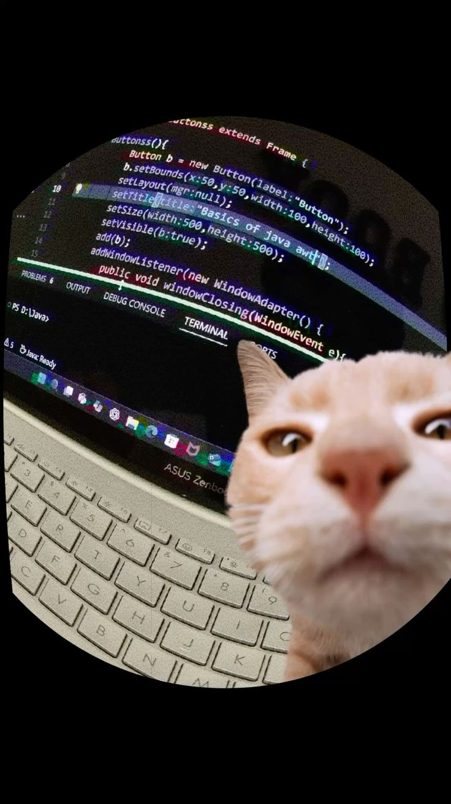

  

<h2 align="center">Tecnologias & Ferramentas</h2>

━━━

  
  
  
  

<h2 align="center">
  Sobre mim
</h2>

  Estudante de Sistemas de Informação no IFS, com foco no desenvolvimento backend.

  Tenho direcionado meus estudos para Java e Spring, explorando construção de APIs,
  modelagem de regras de negócio, persistência de dados e arquitetura de software.

  

<b>Entre em contato:</b>

